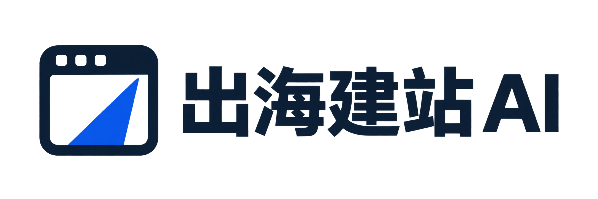
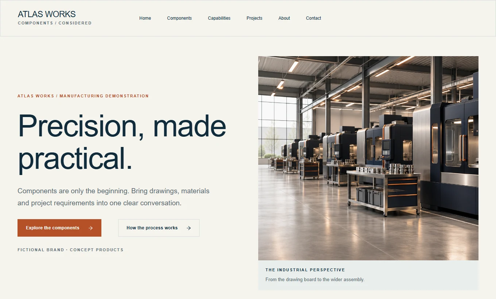
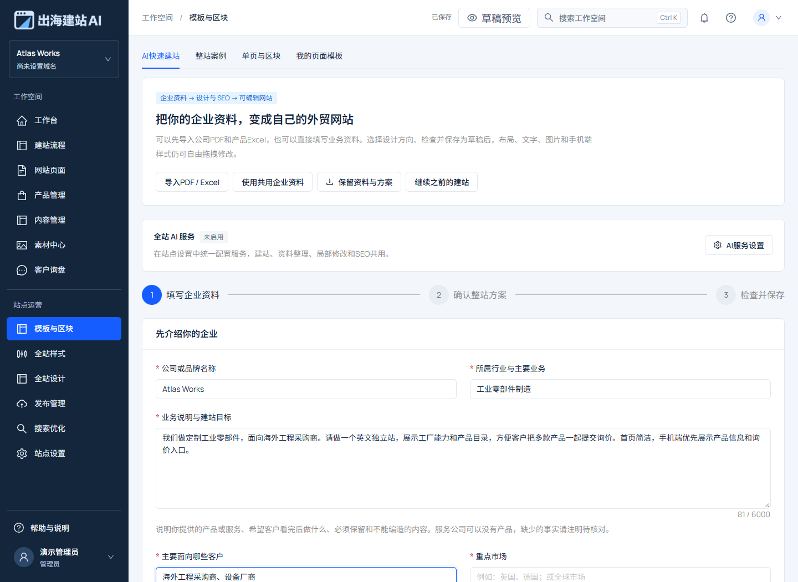
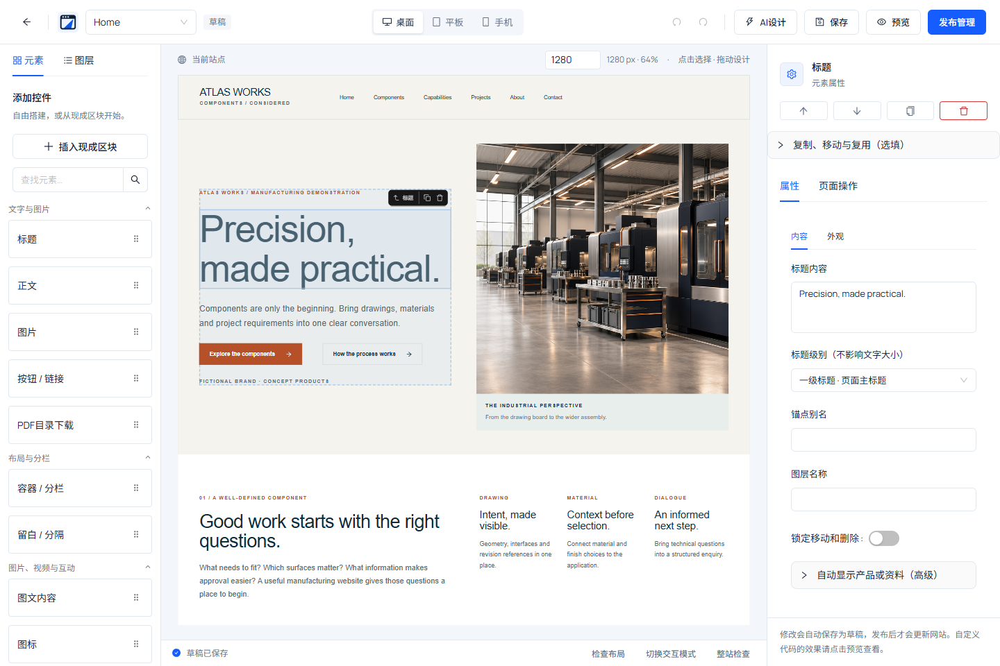
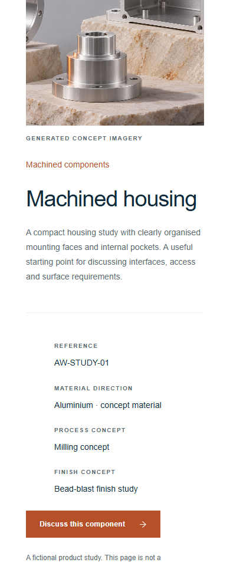
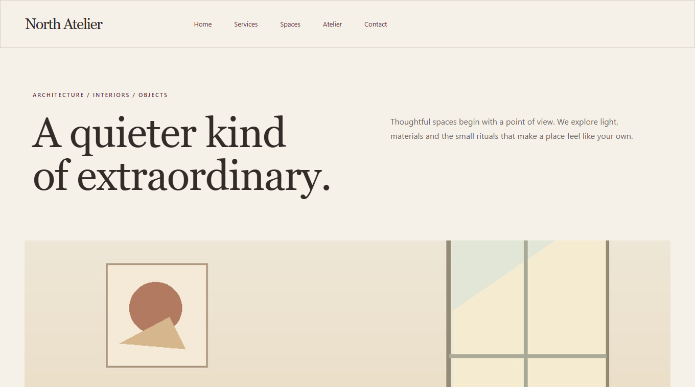

# 出海建站 AI



[简体中文](README.md) · [Screenshots](#screenshots) · [Quick start](#quick-start)

出海建站 AI helps Chinese export businesses build their own B2B websites, even without coding or design experience. Connect a compatible AI provider of your choice and describe your business and products in Chinese. Review the proposed site, refine the pages in a visual editor, and publish when you are ready. The self-hosted workspace includes product catalogs, multilingual content, and requests for quotes.

**0.42.0 Beta** adds product comparison tables, project timelines, before-and-after images, and six reusable section layouts.

## Screenshots

### Manufacturing website

Atlas Works is a fictional starter site. Its home page introduces the company and gives buyers access to its product catalog, project studies, and inquiry form.



### Describe the site and refine its pages

After connecting your own AI provider, enter your business details and requirements. For example, ask for an English-language site for a custom component manufacturer, with a product catalog and a way for overseas buyers to request quotes for several items at once. Review the site preview, save it as a draft, and refine the pages with AI or drag-and-drop before confirming publication.





### Mobile product page



### Interior design website



Both sites are fictional examples available in the starter library. [See the starter site guide](docs/SHOWCASE_THEMES.md)

## Quick start

Use Node.js **22.15 or later within the 22.x line**. Run these commands from the repository root.

```sh
npm ci
npm run setup
npm run build
npm start
```

1. During setup, create the first administrator with your email and a password of at least 12 characters. Setup generates a local instance secret and initializes SQLite.
2. Open [the admin workspace](http://127.0.0.1:3200/admin). Under **站点设置 → AI服务** (Site settings → AI service), connect your compatible AI provider. Open **模板与区块 → AI快速建站** (Templates and blocks → AI site builder), describe what you want to build, and preview the proposed site.
3. Save the result as a draft and adjust the pages as needed. You can also start with a fictional site under **模板与区块 → 整站案例** (Templates and blocks → Site examples).
4. Open **发布管理** (Releases) to review and publish your selected changes. The [public site](http://127.0.0.1:3200/) serves the published version.

## What you can do

- Build pages with drag-and-drop blocks and device-specific layouts. Edit products, categories, and reusable sections.
- Manage drafts and publish selected changes after review. Restore an earlier published version if needed.
- Collect quote requests for multiple products, with quantities and requirements per item. Import product data and preview spreadsheet updates matched by SKU.
- Use AI to build the site, edit individual pages, and draft product introductions. Configure email notifications and other external services for each instance.

[Site examples](docs/SHOWCASE_THEMES.md) · [Blocks](docs/BUSINESS_BLOCKS.md) · [Quote forms](docs/WEBSITE_FORMS.md) · [AI setup](docs/AI_SETTINGS.md)

## Deploy and contribute

A deployment serves one site with one Node writer and local persistent SQLite storage. See the [deployment guide](DEPLOYMENT.md) and [Linux container and backup guide](docs/OPERATIONS.md) for HTTPS, persistence, and recovery.

[Contributing](CONTRIBUTING.md) · [Reporting a security issue](SECURITY.md) · [MIT license](LICENSE) · [Third-party notices](THIRD_PARTY_NOTICES.md)
