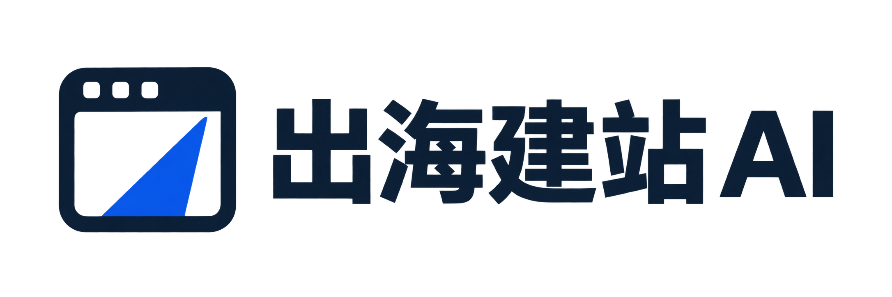
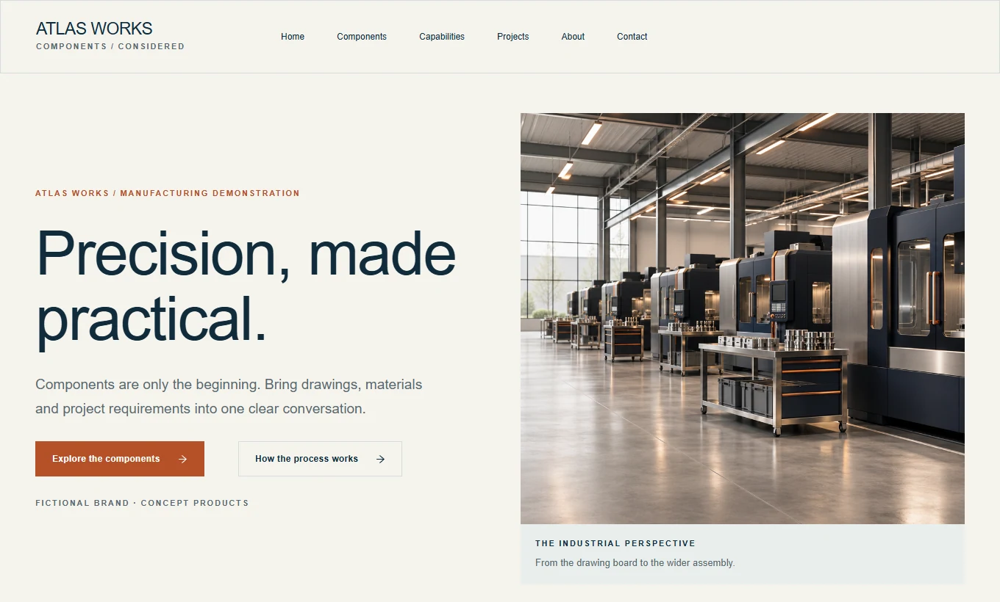
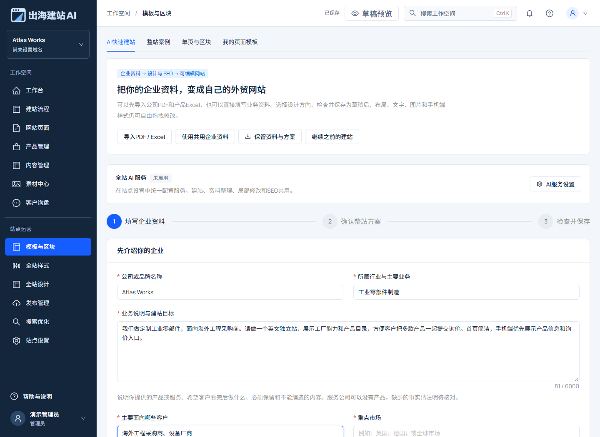
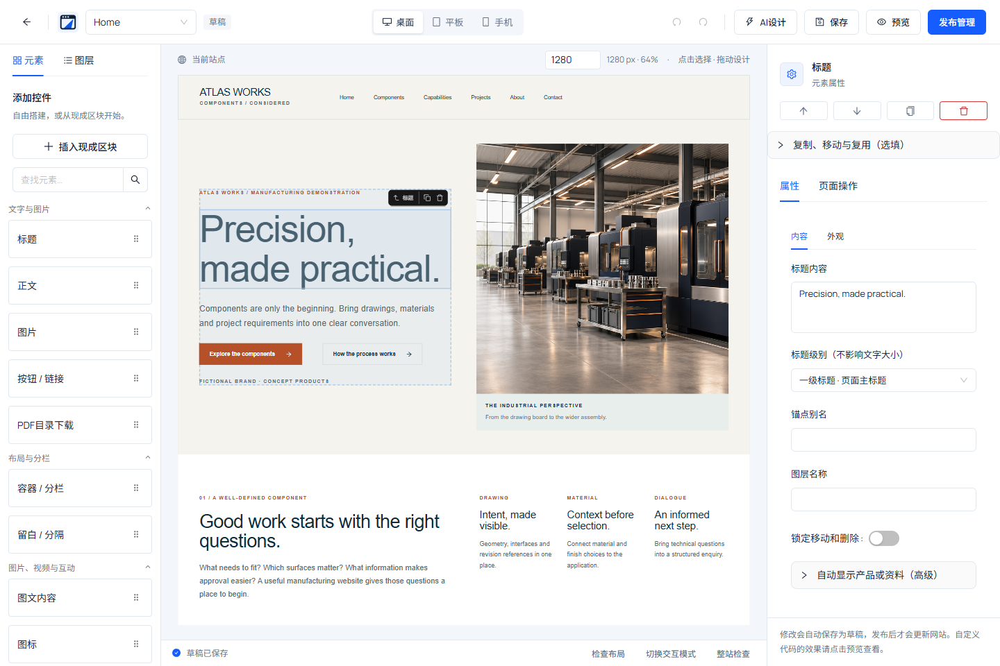
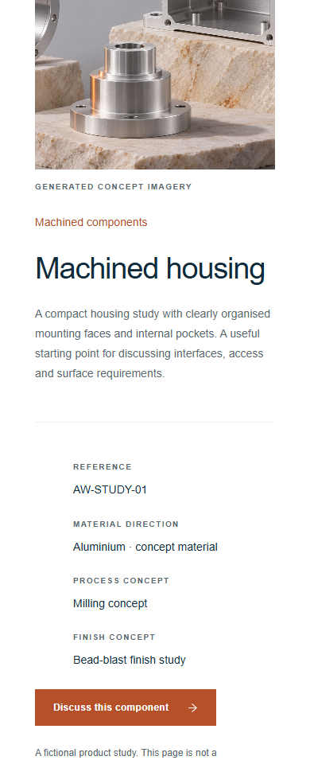
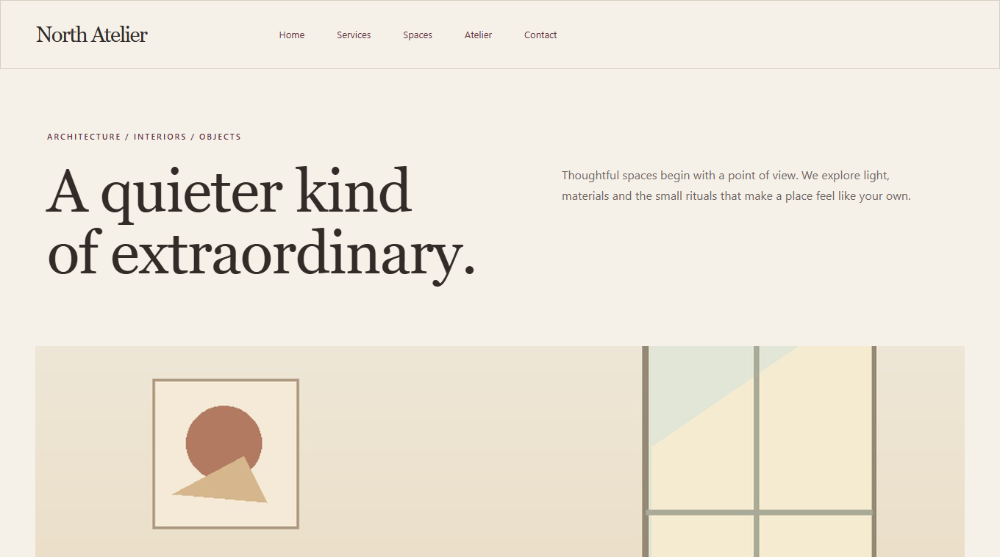

# 出海建站 AI



[English](README.en.md) · [图片示例](#图片示例) · [快速开始](#快速开始)

**给中国外贸团队用的开源独立站建站工具。** 系统部署后，接入团队自己选择的 AI 服务。建站时用中文介绍公司、产品和目标买家，查看生成的建站方案和页面预览。你可以继续用中文调整，或自己拖拽排版。确认后再发布，让海外买家浏览多语言产品目录、查看案例并提交询价。

**0.42.0 Beta** 新增产品型号对比表、项目时间线、图片前后对比和六种现成业务区块。

## 图片示例

### 制造业独立站首页

Atlas Works 是内置的虚构案例。首页介绍公司与制造能力，并提供产品目录、项目案例和询价入口。



### 用中文填写建站需求

在「模板与区块 → AI快速建站」填写公司资料、目标市场和网站需求。

> 我们做定制工业零部件，面向海外工程采购商。请做一个英文独立站，展示工厂能力和产品目录，方便客户把多款产品一起提交询价。首页简洁，手机端优先展示产品信息和询价入口。



### 预览后继续编辑

查看页面预览，确认后保存为草稿。可以用可视化编辑器拖拽区块、更换图片和调整文字，也可以继续用中文请 AI 修改指定页面或区块。



### 手机上看产品和询价

海外买家可以在手机上查看产品图片和规格，从详情页进入询价。



### 空间设计网站

North Atelier 是内置的虚构空间设计案例，以衬线字体、留白和空间插画展示服务。



部署后，可在「模板与区块 → 整站案例」预览和导入这些虚构案例，再替换成自己的资料。[了解内置案例](docs/SHOWCASE_THEMES.md)

## 快速开始

使用 **Node.js 22.15 或同一主版本中更新的 Node.js 22**。在仓库根目录执行：

```sh
npm ci
npm run setup
npm run build
npm start
```

1. 按初始化提示填写首位管理员的邮箱和至少 12 个字符的密码。程序会为该实例生成密钥并初始化 SQLite。
2. 打开[管理后台](http://127.0.0.1:3200/admin)，在「站点设置 → AI服务」接入自己的 AI。进入「模板与区块 → AI快速建站」，用中文说明要做什么网站，再预览建站方案。
3. 将预览结果保存为草稿，按需要拖拽修改页面。也可以在「模板与区块 → 整站案例」预览并导入虚构示例，直接体验页面编辑。
4. 在「发布管理」检查并发布选中的改动。[公开网站](http://127.0.0.1:3200/)会显示已发布版本。

## 主要功能

- 拖拽编辑页面，分别调整桌面、平板和手机布局。集中管理产品、分类和复用区块。
- 在独立草稿内修改，预览确认后发布所选范围，支持切换历史公开版本。
- 买家可以一次提交多款产品、数量和要求。运营人员可按 SKU 预览并确认 Excel 更新。
- 用 AI 搭建整站、调整指定页面和写产品介绍。邮件和其他外部服务可按实例配置。

[整站案例](docs/SHOWCASE_THEMES.md) · [业务区块](docs/BUSINESS_BLOCKS.md) · [网站表单](docs/WEBSITE_FORMS.md) · [AI 配置](docs/AI_SETTINGS.md)

## 部署与参与

每个部署实例服务一个独立网站，使用一个 Node 写进程和本地持久 SQLite 存储。HTTPS、Linux 容器、备份和恢复参见[部署说明](DEPLOYMENT.md)和[运维手册](docs/OPERATIONS.md)。

[贡献指南](CONTRIBUTING.md) · [报告安全问题](SECURITY.md) · [MIT 许可证](LICENSE) · [第三方许可说明](THIRD_PARTY_NOTICES.md)
